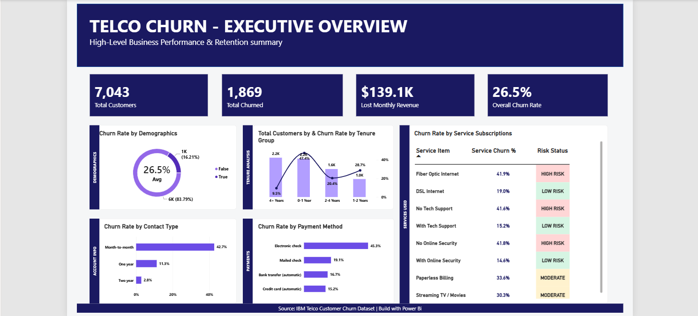
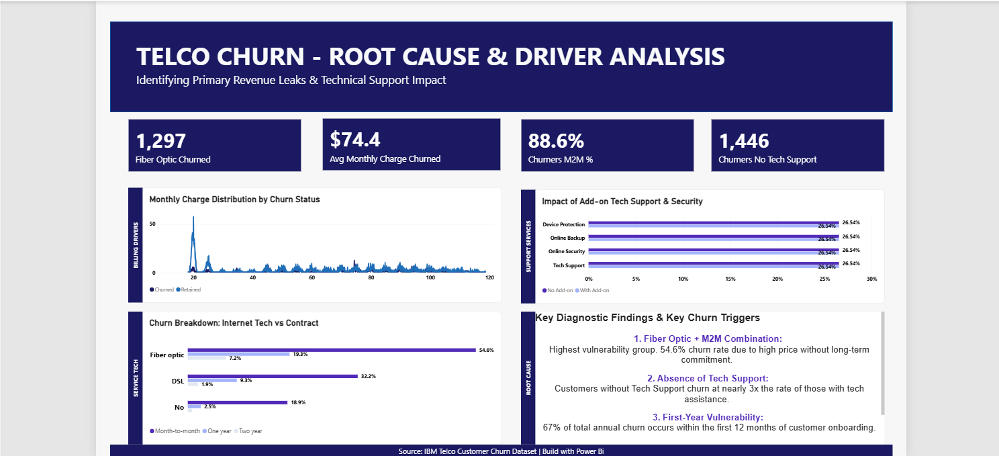
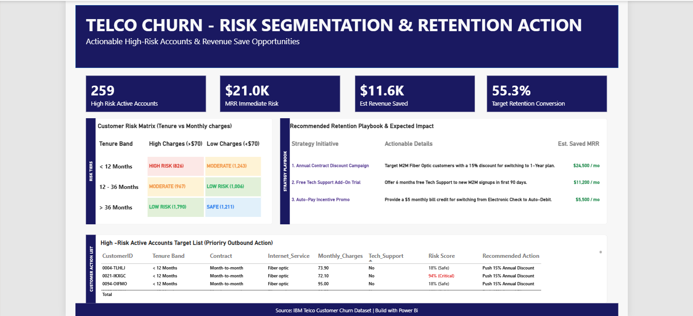

# Customer Churn Analysis & Retention

A 3-page Power BI dashboard that shows why customers leave a telecom company, which customers are most at risk, and what to do about it. It uses the public IBM Telco customer churn dataset (7,043 customers).

**Tools:** Power BI (DAX, star-schema model), Python (pandas, scipy)

Built by Michael Kyalo ([LinkedIn](https://www.linkedin.com/in/kyalo-michael-7548483b5/))

---

## Dashboard Preview

### Page 1: Executive Overview
Headline KPIs (total customers, total churned, lost monthly revenue, overall churn rate), plus churn by demographics, tenure group, contract type, payment method and service subscription.



### Page 2: Root Cause & Driver Analysis
Churn by monthly charge tier, by add-on service (Tech Support, Online Security, Online Backup, Device Protection), and by contract type and internet service.



### Page 3: Risk Segmentation & Action Plan
Customers grouped into high, medium and low churn risk, with action lists for retention outreach.



---

## Key Findings

**Scale:** 7,043 customers, 1,869 of whom have churned (26.5%). Churned customers were paying about $139.1K a month in total, which is 30.5% of all monthly revenue.

1. **Contract type is the strongest signal.** Month-to-month customers churn at 42.7%, against 11.3% on one-year contracts and 2.8% on two-year contracts.
2. **Fiber optic customers on month-to-month contracts are the biggest risk.** Their churn rate is 54.6%, more than double the overall rate.
3. **Customers without tech support leave far more often.** 41.6% of them churn, against 15.2% of customers who have it, about 2.7 times as often. Online Security shows a similar gap (41.8% without, 14.6% with).
4. **The first year is the danger zone.** Customers in their first year churn at 47.4%, falling to 9.5% after four years. About 56% of all churned customers left within their first 12 months.
5. **Electronic check payers churn more.** 45.3% of electronic check customers churn, against 15% to 19% for the other payment methods. This may point to billing friction.

---

## Recommendations

These are hypotheses to test, based on the patterns above.

- **Offer annual-contract incentives to fiber optic customers on month-to-month plans,** for example a discount for switching to a 12-month term.
- **Bundle tech support** into early plans or offer it free for the first months, since customers without it churn at a much higher rate.
- **Build a first-year retention programme,** such as check-in contacts and offers during months 1 to 12.
- **Encourage automatic payments** for electronic check customers, for example with a small bill credit.

---

## Method

1. **Clean (Python, pandas):** fixed missing `TotalCharges` values for new sign-ups, grouped customers into tenure cohorts (0-1, 1-2, 2-4 and 4+ years), counted add-on services per customer, and exported the cleaned data. See `data cleaning.ipynb`.
2. **Test (Python, scipy):** checked which factors are statistically linked to churn (see below). See `data testing.ipynb`.
3. **Model and visualise (Power BI):** built a star schema with DAX measures and a 3-page report.

---

## Statistical Testing

Chi-square tests for categorical factors and t-tests for numeric ones, all against the churn flag. Every factor tested was significant (p < 0.05).

| Factor | Test | Result |
|---|---|---|
| Contract | Chi-square | 1184.6 (strongest) |
| Online Security | Chi-square | 850.0 |
| Tech Support | Chi-square | 828.2 |
| Internet Service | Chi-square | 732.3 |
| Payment Method | Chi-square | 648.1 |
| Senior Citizen | Chi-square | 159.4 |
| Monthly Charges | t-test | 18.4 (churned customers pay more) |
| Tenure | t-test | -34.8 (churned customers have shorter tenure) |
| CLTV | t-test | -10.7 (churned customers have lower lifetime value) |

With about 7,000 customers, almost any difference shows up as significant, so the size of each difference (the churn rates above) matters more than the p-values.

---

## Data Model

Star schema centred on `fact_churn`:

- `fact_churn` to `dim_customers` (one-to-many on `CustomerID`)
- `fact_churn` to `dim_services` (one-to-many on `ServiceID`)
- `fact_churn` to `dim_contracts` (one-to-many on `ContractID`)
- `Service_Risk_Summary`: a calculated DAX table used to compare churn across services

### Core DAX Measures

```
Total Churned Customers =
CALCULATE(COUNT(fact_churn[CustomerID]), fact_churn[Churn_Flag] = 1)

Overall Churn Rate =
DIVIDE([Total Churned Customers], COUNT(fact_churn[CustomerID]), 0)

Service Churn Rate =
AVERAGE(Service_Risk_Summary[Churn_Flag])

Lost Monthly Revenue =
CALCULATE(
    SUM(telco_churn[Monthly_Charges]),
    telco_churn[Churn_Value] = 1
)
```

---

## Files

- [`Customer-Churn-Analysis-Retention.pbix`](Customer-Churn-Analysis-Retention.pbix): the Power BI report (open with Power BI Desktop)
- [`screenshots/`](screenshots): dashboard page images
- [`Telco_customer_Churn.xlsx`](Telco_customer_Churn.xlsx): raw data
- [`cleaned_telco_churn.csv`](cleaned_telco_churn.csv): cleaned data
- [`Data cleaning & testing/data cleaning.ipynb`](Data%20cleaning%20%26%20testing/data%20cleaning.ipynb): cleans the raw data
- [`Data cleaning & testing/data testing.ipynb`](Data%20cleaning%20%26%20testing/data%20testing.ipynb): statistical tests (chi-square and t-tests) and churn-driver charts

---

## About Me

I'm Michael Kyalo, an aspiring data analyst who enjoys finding the reasons behind business problems in data. This project combines Python statistical testing and Power BI, and I'm looking for a data analyst role where I can do the same with real business data.

**Tools:** Python (pandas, scipy), Power BI (DAX)

**Connect:** [LinkedIn](https://www.linkedin.com/in/kyalo-michael-7548483b5/) | [mikekyalo.c@gmail.com](mailto:mikekyalo.c@gmail.com)
